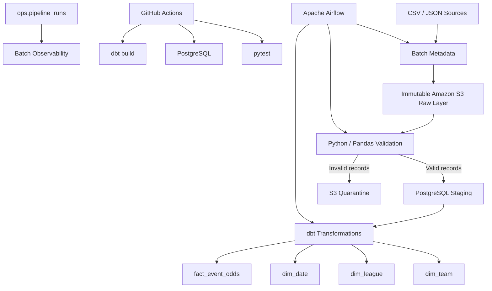
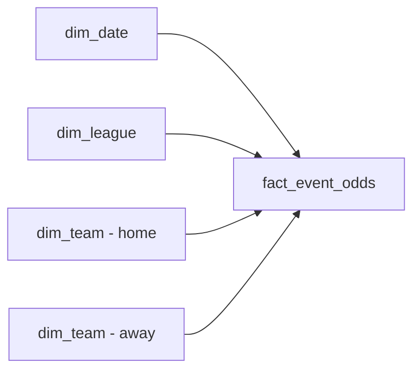

# Sports Data Engineering Pipeline

[](https://github.com/Kutaba-Victor-30127/sports-data-engineering-pipeline/actions)

End-to-end data engineering pipeline built with **Python, AWS S3, PostgreSQL, dbt, Apache Airflow, Docker, pytest and GitHub Actions**.

The project ingests structured CSV and semi-structured JSON sports-event data, stores immutable raw batches in Amazon S3, validates and quarantines bad records, performs replay-safe incremental UPSERTs into PostgreSQL, builds a dimensional warehouse with dbt, and tracks batch-level execution metrics.

## Architecture



## Key Engineering Features

- Immutable S3 ingestion batches partitioned by `ingestion_date` and `batch_id`
- Incremental PostgreSQL ingestion using `INSERT ... ON CONFLICT DO UPDATE`
- Version-aware UPSERTs using `source_updated_at`
- Replay-safe and idempotent ingestion
- Row-level data validation and S3 quarantine
- Centralized event data contract
- Batch-level observability with `run_id`, row counts and execution status
- SUCCESS / FAILED execution tracking with error messages
- Apache Airflow orchestration with retries and task dependencies
- Dimensional warehouse built with dbt
- Automated Python and dbt data-quality tests
- Dockerized local infrastructure
- GitHub Actions CI with clean PostgreSQL provisioning

## Tech Stack

| Area | Technologies |
|---|---|
| Language | Python |
| Data Processing | Pandas |
| Cloud Storage | AWS S3 |
| AWS SDK | boto3 |
| Database | PostgreSQL |
| Database Access | SQLAlchemy, psycopg2 |
| Transformations | dbt |
| Orchestration | Apache Airflow |
| Containerization | Docker, Docker Compose |
| Testing | pytest, dbt tests |
| CI/CD | GitHub Actions |
| Version Control | Git, GitHub |

## Immutable S3 Raw Layer

Every ingestion creates a unique batch:

```text
raw/events/
└── ingestion_date=2026-11-02/
    └── batch_id=<UUID>/
        ├── events.csv
        └── events.json
```

The batch metadata contains:

```text
batch_id
ingestion_date
csv_key
json_key
```

`batch_id` identifies the source batch, while each processing attempt receives its own `run_id`.

This separation allows the same raw batch to be replayed multiple times without losing execution history.

### S3 Raw Data


## Incremental and Replay-Safe Ingestion

Validated records are loaded into:

```text
staging.raw_events
```

The pipeline does not truncate staging on every run.

Instead, PostgreSQL performs an UPSERT on `event_id`.

An existing event is updated only when:

```text
incoming source_updated_at > stored source_updated_at
```

Example:

```text
Batch A
event_id = 1
home_odds = 1.90
source_updated_at = 10:00

Batch B
event_id = 1
home_odds = 1.95
source_updated_at = 11:00
```

After Batch B, replaying Batch A does not overwrite the newer value.

This provides:

- idempotency
- replay safety
- incremental ingestion
- protection against stale source data

## Data Validation and Data Contract

The event contract defines the expected source schema and business requirements.

Required fields include:

```text
event_id
sport
league
home_team
away_team
event_time
home_odds
draw_odds
away_odds
source_updated_at
```

Validation includes:

- required columns
- required non-null values
- unique `event_id` within a batch
- different home and away teams
- valid timestamps
- numeric betting odds
- positive betting odds
- valid `source_updated_at`

Invalid numeric and timestamp values are safely coerced and rejected instead of crashing the pipeline.

## Quarantine Layer

Validation separates incoming records into:

```text
valid_df
rejected_df
```

Valid records continue to PostgreSQL.

Rejected records are written to:

```text
rejected/events/
└── ingestion_date=<date>/
    └── batch_id=<UUID>/
        └── rejected.json
```

Each quarantined record preserves:

```text
original source values
batch_id
source_file
rejection_reason
```

This prevents bad records from reaching the warehouse while keeping them available for investigation.

## Batch Observability

Pipeline execution metadata is stored in:

```text
ops.pipeline_runs
```

The model separates:

```text
batch_id = identity of the source data
run_id   = identity of one processing attempt
```

This allows one batch to have multiple attempts:

```text
batch-A
├── run 1 → SUCCESS
├── run 2 → replay → SUCCESS
└── run 3 → retry → FAILED
```

Tracked metrics include:

```text
source_row_count
valid_row_count
rejected_row_count
inserted_count
updated_count
ignored_count
started_at
finished_at
status
error_message
```

Metrics are checkpointed during processing, allowing failed runs to retain information already measured before the failure.

The staging UPSERT and final SUCCESS update are executed within the same database transaction to avoid inconsistent execution state.

## dbt Warehouse

After ingestion, dbt transforms staging data into an analytics warehouse.

### Staging

```text
analytics.stg_events
```

### Dimensions

```text
analytics.dim_team
analytics.dim_league
analytics.dim_date
```

### Fact Table

```text
analytics.fact_event_odds
```

The fact table contains event-level betting odds and foreign keys to the related dimensions.



## Automated Data Quality

The project uses both Python and dbt testing.

### pytest

The current Python suite contains **12 automated tests** covering scenarios including:

- valid event validation
- negative odds rejection
- non-numeric odds rejection
- invalid timestamps
- missing source version
- event contract validation
- idempotent incremental ingestion
- replay safety
- quarantine creation
- valid batches avoiding quarantine
- successful observability runs
- failed run error tracking

Run:

```bash
python -m pytest -v
```

### dbt

The dbt build executes:

```text
4 table models
1 view model
21 data tests
26 total operations
```

Tests include:

- `not_null`
- `unique`
- fact-to-dimension relationships
- positive betting odds

A successful build finishes with:

```text
PASS=26
WARN=0
ERROR=0
TOTAL=26
```

### Successful dbt Build


## Apache Airflow

Airflow orchestrates the pipeline through:

```text
sports_data_pipeline
```

The workflow is:

```text
upload raw batch
        ↓
validate JSON
        ↓
process batch through shared ingestion flow
        ↓
dbt build
```

The same ingestion logic is reused by:

- manual execution
- historical replay
- Airflow

This avoids separate implementations with different behavior.

The DAG includes:

```text
retries = 2
retry_delay = 30 seconds
```

### Successful Airflow Run


## Continuous Integration

GitHub Actions runs automatically on:

```text
push → main
pull request → main
```

The CI workflow:

```text
Checkout repository
        ↓
Set up Python
        ↓
Install dependencies
        ↓
Provision PostgreSQL
        ↓
Apply database schemas and migrations
        ↓
Run pytest
        ↓
Load sample staging data
        ↓
Run dbt build
```

The database is provisioned from a clean PostgreSQL service, which verifies that the project does not depend on manually configured local state.

### GitHub Actions Success


## Docker Infrastructure

Docker Compose runs:

```text
sports_postgres
sports_airflow
```

Host PostgreSQL access:

```text
localhost:5433
```

Container-to-container connection:

```text
postgres:5432
```

Database initialization automatically applies:

```text
create_staging.sql
004_pipeline_runs.sql
005_pipeline_run_attempts.sql
```

## Project Structure

```text
sports-data-engineering-pipeline/
├── .github/
│   └── workflows/
│       └── ci.yml
├── airflow/
│   ├── dags/
│   │   └── sports_pipeline_dag.py
│   └── dbt/
│       └── profiles.yml
├── data/
│   └── raw/
│       ├── events.csv
│       └── events.json
├── docs/
│   ├── airflow-success.png
│   ├── dbt-build-success.png
│   ├── github-actions-success.png
│   └── s3-raw-events.png
├── sports_warehouse/
│   ├── models/
│   │   ├── staging/
│   │   └── marts/
│   └── tests/
│       └── assert_positive_event_odds.sql
├── sql/
│   ├── create_staging.sql
│   ├── 004_pipeline_runs.sql
│   └── 005_pipeline_run_attempts.sql
├── src/
│   ├── aws/
│   ├── contracts/
│   │   └── event_contract.py
│   ├── database/
│   ├── ingestion/
│   │   ├── load_events.py
│   │   ├── load_json_events.py
│   │   └── run_batch.py
│   ├── observability/
│   │   └── pipeline_runs.py
│   └── validation/
│       └── event_validator.py
├── tests/
│   ├── test_incremental_ingestion.py
│   ├── test_ingestion.py
│   ├── test_observability.py
│   └── test_quarantine.py
├── .env.example
├── docker-compose.yml
├── Dockerfile.airflow
├── requirements.txt
└── README.md
```

## Running Locally

### 1. Clone

```bash
git clone https://github.com/Kutaba-Victor-30127/sports-data-engineering-pipeline.git
cd sports-data-engineering-pipeline
```

### 2. Virtual Environment

```bash
python -m venv .venv
```

Windows PowerShell:

```powershell
.\.venv\Scripts\Activate.ps1
```

Install dependencies:

```bash
pip install -r requirements.txt
```

### 3. Environment Configuration

Create `.env` from `.env.example`.

Example:

```env
POSTGRES_HOST=localhost
POSTGRES_DB=sports_warehouse
POSTGRES_USER=sports_user
POSTGRES_PASSWORD=your_password
POSTGRES_PORT=5433

AWS_REGION=eu-north-1
S3_BUCKET_NAME=your-s3-bucket-name

AWS_CREDENTIALS_PATH=C:/Users/your-user/.aws
```

AWS credentials are stored outside the repository.

### 4. Start Infrastructure

```bash
docker compose up -d --build
```

### 5. Run the Pipeline

```bash
python -m src.ingestion.run_batch
```

The command:

```text
creates batch metadata
→ uploads an immutable S3 batch
→ validates records
→ quarantines invalid records
→ incrementally UPSERTs valid records
→ records execution metrics
```

### 6. Replay an Existing Batch

```bash
python -m src.ingestion.load_events \
  --s3-key "<existing-s3-key>" \
  --batch-id "<existing-batch-id>"
```

The replay receives a new `run_id` while preserving the original `batch_id`.

### 7. Run Tests

```bash
python -m pytest -v
```

### 8. Run dbt

```bash
cd sports_warehouse
dbt build
```

### 9. Run Airflow

Airflow UI:

```text
http://localhost:8082
```

Trigger:

```text
sports_data_pipeline
```

## Security

Security practices include:

- `.env` excluded from Git
- AWS credentials stored outside the repository
- `.env.example` contains templates only
- dedicated IAM identity for project access
- project-scoped S3 permissions
- no AWS root access keys
- environment-driven Docker configuration

## Engineering Concepts Demonstrated

- Python data engineering
- SQL and relational databases
- ETL / ELT
- AWS S3
- immutable raw data
- batch processing
- incremental ingestion
- UPSERT
- idempotency
- replay safety
- data contracts
- data validation
- quarantine patterns
- batch observability
- database transactions
- PostgreSQL
- SQLAlchemy
- Pandas
- dbt
- dimensional modelling
- fact and dimension tables
- data-quality testing
- Apache Airflow
- orchestration and retries
- Docker
- pytest
- GitHub Actions
- CI
- logging
- secure configuration

## Future Improvements

Potential next steps:

- reproducible performance benchmark with a larger dataset
- additional observability metrics and alerting
- external sports API ingestion
- BI dashboard on top of the analytics warehouse
- infrastructure as code

## Author

**Victor Kutaba**

GitHub: Kutaba-Victor-30127