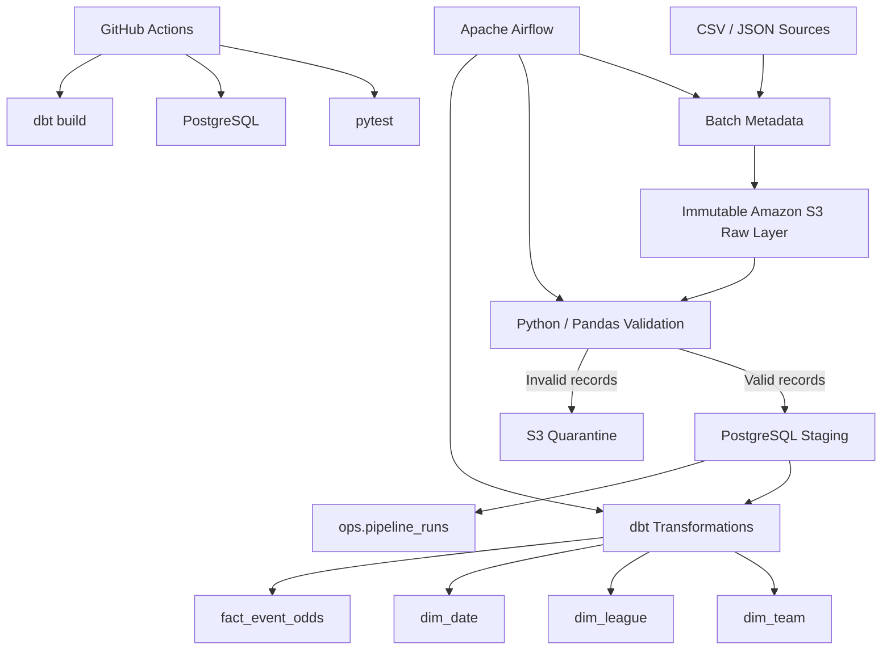
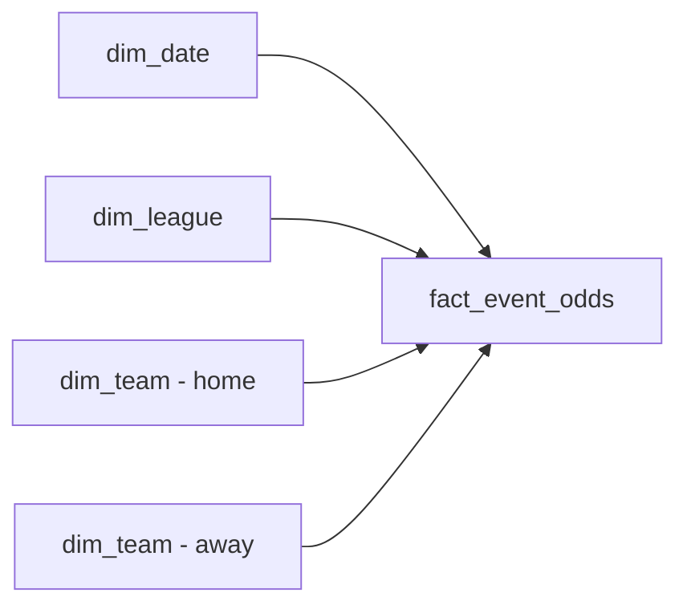

# Sports Data Engineering Pipeline

[](https://github.com/Kutaba-Victor-30127/sports-data-engineering-pipeline/actions)

Production-style data engineering project built with **Python, AWS S3, PostgreSQL, dbt, Apache Airflow, Docker, pytest and GitHub Actions**.

The pipeline ingests structured CSV and semi-structured JSON sports-event data, stores immutable raw batches in Amazon S3, validates and quarantines invalid records, performs replay-safe incremental UPSERTs into PostgreSQL, builds a dimensional analytics warehouse with dbt, tracks batch execution metrics and includes reproducible ingestion benchmarks.

## Architecture



## Key Engineering Features

- Immutable Amazon S3 raw batches partitioned by `ingestion_date` and `batch_id`
- Incremental PostgreSQL ingestion using `INSERT ... ON CONFLICT DO UPDATE`
- Version-aware updates using `source_updated_at`
- Replay-safe and idempotent processing
- Row-level validation and S3 quarantine for rejected records
- Centralized event data contract
- Batch-level observability using `run_id`
- Inserted, updated, ignored, valid and rejected row metrics
- SUCCESS / FAILED execution tracking
- Transactional staging load and execution-state updates
- Apache Airflow orchestration
- Dimensional analytics warehouse built with dbt
- Automated Python and dbt data-quality testing
- Dockerized infrastructure
- GitHub Actions CI
- Reproducible PostgreSQL ingestion performance benchmarks

## Tech Stack

| Area | Technologies |
|---|---|
| Language | Python |
| Data Processing | pandas |
| Cloud Storage | AWS S3 |
| AWS SDK | boto3 |
| Database | PostgreSQL |
| Database Access | SQLAlchemy, psycopg2 |
| Transformations | dbt |
| Orchestration | Apache Airflow |
| Containerization | Docker, Docker Compose |
| Testing | pytest, dbt tests |
| CI/CD | GitHub Actions |
| Version Control | Git, GitHub |

## Immutable S3 Raw Layer

Each ingestion creates a unique immutable batch:

```text
raw/events/
└── ingestion_date=2026-11-03/
    └── batch_id=<UUID>/
        ├── events.csv
        └── events.json
```

Batch metadata contains:

```text
batch_id
ingestion_date
csv_key
json_key
```

`batch_id` represents the identity of the source data.

Each processing attempt receives a separate `run_id`, allowing the same immutable source batch to be replayed or retried without losing execution history.

### S3 Raw Data


## Incremental and Replay-Safe Ingestion

Validated records are loaded into:

```text
staging.raw_events
```

The production ingestion path does not truncate staging on every run.

Instead, PostgreSQL performs an UPSERT using `event_id` as the conflict key.

An existing record is updated only when:

```text
incoming source_updated_at > stored source_updated_at
```

Example:

```text
Batch A

event_id = 1
home_odds = 1.90
source_updated_at = 10:00
```

A later batch contains:

```text
Batch B

event_id = 1
home_odds = 1.95
source_updated_at = 11:00
```

Batch B updates the existing event.

If Batch A is replayed afterwards, its older version cannot overwrite the newer value.

This provides:

- idempotency
- replay safety
- incremental ingestion
- protection against stale source data

## Data Validation and Contract

The centralized event contract defines the expected input schema and core business rules.

Required fields include:

```text
event_id
sport
league
home_team
away_team
event_time
home_odds
draw_odds
away_odds
source_updated_at
```

Validation includes:

- required columns
- non-null required values
- unique `event_id` values within the batch
- different home and away teams
- valid timestamps
- numeric betting odds
- positive betting odds
- valid source version timestamps

Numeric and timestamp values are converted using safe coercion.

Invalid records are rejected instead of crashing the entire batch.

## Quarantine Layer

Validation partitions each batch into:

```text
valid_df
rejected_df
```

Valid records continue to PostgreSQL.

Rejected records are written to:

```text
rejected/events/
└── ingestion_date=<date>/
    └── batch_id=<UUID>/
        └── rejected.json
```

Each rejected record preserves metadata including:

```text
batch_id
source_file
rejection_reason
```

This prevents invalid records from reaching the warehouse while preserving them for investigation.

## Batch Observability

Pipeline execution metadata is stored in:

```text
ops.pipeline_runs
```

The observability model separates source identity from execution identity:

```text
batch_id = identity of the source batch
run_id   = identity of one processing attempt
```

A single source batch can therefore have multiple attempts:

```text
batch-A
├── run 1 → SUCCESS
├── run 2 → replay → SUCCESS
└── run 3 → retry → FAILED
```

Tracked information includes:

```text
source_row_count
valid_row_count
rejected_row_count
inserted_count
updated_count
ignored_count
started_at
finished_at
status
error_message
```

Counts are checkpointed while the batch is processed, allowing failed executions to retain metrics collected before the failure.

The PostgreSQL staging UPSERT and the final SUCCESS state are committed within the same transaction to avoid inconsistent pipeline state.

## dbt Analytics Warehouse

After ingestion, dbt transforms staging records into a dimensional analytics model.

### Staging Model

```text
analytics.stg_events
```

### Dimensions

```text
analytics.dim_team
analytics.dim_league
analytics.dim_date
```

### Fact Table

```text
analytics.fact_event_odds
```

The fact table stores event-level betting odds and foreign keys to the related dimensions.



## Automated Testing and Data Quality

The project uses Python tests for application behavior and dbt tests for warehouse data quality.

### pytest

The current Python test suite contains **12 automated tests** covering scenarios including:

- valid event validation
- negative odds rejection
- non-numeric odds rejection
- invalid timestamps
- missing source versions
- event contract validation
- incremental ingestion
- idempotent replay
- stale-version replay protection
- quarantine creation
- successful observability tracking
- failed-run error tracking

Run:

```bash
python -m pytest -v
```

### dbt

The dbt build currently executes:

```text
4 table models
1 view model
21 data tests
26 total dbt operations
```

Tests cover:

- `not_null`
- `unique`
- fact-to-dimension relationships
- positive betting odds

A successful build finishes with:

```text
PASS=26
WARN=0
ERROR=0
TOTAL=26
```

### Successful dbt Build


## Apache Airflow Orchestration

Airflow orchestrates the pipeline using:

```text
sports_data_pipeline
```

The workflow is:

```text
create and upload immutable batch
        ↓
validate source data
        ↓
process batch through shared ingestion flow
        ↓
run dbt transformations and tests
```

The same ingestion implementation is reused by:

- manual execution
- historical replay
- Airflow

This avoids separate ingestion implementations with different behavior.

The DAG includes:

```text
retries = 2
retry_delay = 30 seconds
```

### Successful Airflow Run


## Continuous Integration

GitHub Actions runs automatically on:

```text
push → main
pull request → main
```

The workflow:

```text
Checkout repository
        ↓
Set up Python
        ↓
Install dependencies
        ↓
Provision PostgreSQL
        ↓
Apply schemas and migrations
        ↓
Run pytest
        ↓
Load sample staging data
        ↓
Run dbt build
```

CI creates PostgreSQL from a clean service instead of relying on manually configured local database state.

### GitHub Actions Success


## Performance Benchmark

The PostgreSQL incremental ingestion path was benchmarked locally with synthetic datasets of **10,000** and **100,000 sports-event records**.

The benchmark measures the real `load_to_staging()` path, including:

```text
prepared pandas DataFrame
        ↓
existing-version lookup
        ↓
insert / update / ignore classification
        ↓
SQLAlchemy
        ↓
PostgreSQL UPSERT
```

It intentionally excludes S3 transfer, source validation, Airflow orchestration and dbt execution.

### Results

| Scenario | Rows | Time | Throughput | Inserted | Updated | Ignored |
|---|---:|---:|---:|---:|---:|---:|
| Initial load | 10,000 | 7.565 s | 1,322 rows/s | 10,000 | 0 | 0 |
| Idempotent replay | 10,000 | 8.082 s | 1,237 rows/s | 0 | 0 | 10,000 |
| 10% incremental update | 10,000 | 7.218 s | 1,385 rows/s | 0 | 1,000 | 9,000 |
| Initial load | 100,000 | 76.099 s | 1,314 rows/s | 100,000 | 0 | 0 |
| Idempotent replay | 100,000 | 73.133 s | 1,367 rows/s | 0 | 0 | 100,000 |
| 10% incremental update | 100,000 | 71.452 s | 1,400 rows/s | 0 | 10,000 | 90,000 |

The benchmark demonstrates approximately stable throughput of **1.2k–1.4k rows/second** when increasing the dataset from 10,000 to 100,000 records.

It also verifies ingestion correctness:

```text
Initial load
100,000 new records
→ 100,000 inserted

Idempotent replay
same 100,000 records
→ 0 inserted
→ 0 updated
→ 100,000 ignored

10% incremental update
10,000 newer records
90,000 unchanged records
→ 10,000 updated
→ 90,000 ignored
```

Benchmark execution is wrapped in a PostgreSQL transaction and rolled back after completion, leaving existing staging data unchanged.

### Run the Benchmark

Start PostgreSQL first:

```bash
docker compose up -d
```

Run 10,000 records:

```bash
python -m benchmarks.benchmark_ingestion --row-count 10000
```

Run 100,000 records:

```bash
python -m benchmarks.benchmark_ingestion --row-count 100000
```

Or benchmark multiple sizes:

```bash
python -m benchmarks.benchmark_ingestion --row-count 10000 100000
```

The benchmark is intended to provide reproducible measurements rather than claim end-to-end production throughput.

## Docker Infrastructure

Docker Compose runs the main services:

```text
sports_postgres
sports_airflow
```

Host PostgreSQL access:

```text
localhost:5433
```

Container-to-container access:

```text
postgres:5432
```

Database initialization applies:

```text
create_staging.sql
004_pipeline_runs.sql
005_pipeline_run_attempts.sql
```

## Project Structure

```text
sports-data-engineering-pipeline/
├── .github/
│   └── workflows/
│       └── ci.yml
├── airflow/
│   ├── dags/
│   │   └── sports_pipeline_dag.py
│   └── dbt/
│       └── profiles.yml
├── benchmarks/
│   └── benchmark_ingestion.py
├── data/
│   └── raw/
│       ├── events.csv
│       └── events.json
├── docs/
│   ├── airflow-success.png
│   ├── dbt-build-success.png
│   ├── github-actions-success.png
│   └── s3-raw-events.png
├── sports_warehouse/
│   ├── models/
│   │   ├── staging/
│   │   └── marts/
│   └── tests/
│       └── assert_positive_event_odds.sql
├── sql/
│   ├── create_staging.sql
│   ├── 004_pipeline_runs.sql
│   └── 005_pipeline_run_attempts.sql
├── src/
│   ├── aws/
│   ├── contracts/
│   │   └── event_contract.py
│   ├── database/
│   ├── ingestion/
│   │   ├── load_events.py
│   │   ├── load_json_events.py
│   │   └── run_batch.py
│   ├── observability/
│   │   └── pipeline_runs.py
│   └── validation/
│       └── event_validator.py
├── tests/
│   ├── test_incremental_ingestion.py
│   ├── test_ingestion.py
│   ├── test_observability.py
│   └── test_quarantine.py
├── .env.example
├── docker-compose.yml
├── Dockerfile.airflow
├── requirements.txt
└── README.md
```

## Running Locally

### 1. Clone the Repository

```bash
git clone https://github.com/Kutaba-Victor-30127/sports-data-engineering-pipeline.git
cd sports-data-engineering-pipeline
```

### 2. Create a Virtual Environment

```bash
python -m venv .venv
```

Windows PowerShell:

```powershell
.\.venv\Scripts\Activate.ps1
```

Install dependencies:

```bash
pip install -r requirements.txt
```

### 3. Configure Environment Variables

Create `.env` using `.env.example`.

Example:

```env
POSTGRES_HOST=localhost
POSTGRES_DB=sports_warehouse
POSTGRES_USER=sports_user
POSTGRES_PASSWORD=your_password
POSTGRES_PORT=5433

AWS_REGION=eu-north-1
S3_BUCKET_NAME=your-s3-bucket-name

AWS_CREDENTIALS_PATH=C:/Users/your-user/.aws
```

AWS credentials remain outside the repository.

### 4. Start Infrastructure

```bash
docker compose up -d --build
```

### 5. Run the Pipeline

```bash
python -m src.ingestion.run_batch
```

The ingestion flow:

```text
create batch metadata
        ↓
upload immutable S3 batch
        ↓
validate records
        ↓
quarantine rejected records
        ↓
incrementally UPSERT valid records
        ↓
record execution metrics
```

### 6. Replay an Existing Batch

```bash
python -m src.ingestion.load_events \
  --s3-key "<existing-s3-key>" \
  --batch-id "<existing-batch-id>"
```

A replay preserves the original `batch_id` but receives a new `run_id`.

### 7. Run Python Tests

```bash
python -m pytest -v
```

### 8. Run dbt

```bash
cd sports_warehouse
dbt build
```

### 9. Run Airflow

Airflow UI:

```text
http://localhost:8082
```

Trigger:

```text
sports_data_pipeline
```

## Security

Security practices include:

- `.env` excluded from Git
- AWS credentials stored outside the repository
- `.env.example` containing templates only
- dedicated IAM identity for project access
- project-scoped S3 permissions
- no AWS root access keys
- environment-driven Docker configuration

## Engineering Concepts Demonstrated

- Python data engineering
- SQL and relational databases
- ETL / ELT
- AWS S3
- immutable raw storage
- batch processing
- incremental ingestion
- PostgreSQL UPSERT
- idempotency
- replay safety
- source versioning
- data contracts
- row-level validation
- quarantine patterns
- batch observability
- database transactions
- PostgreSQL
- SQLAlchemy
- pandas
- dbt
- dimensional modelling
- fact and dimension tables
- data-quality testing
- Apache Airflow
- orchestration and retries
- Docker
- pytest
- GitHub Actions
- CI
- reproducible performance benchmarking
- logging
- secure configuration

## Future Improvements

Potential next steps:

- optimize large-batch ingestion using PostgreSQL bulk-loading strategies
- extend pipeline metrics and alerting
- ingest data from an external sports API
- build a BI dashboard on top of the analytics warehouse
- manage cloud infrastructure through Infrastructure as Code

## Author

**Victor Kutaba**

GitHub: Kutaba-Victor-30127