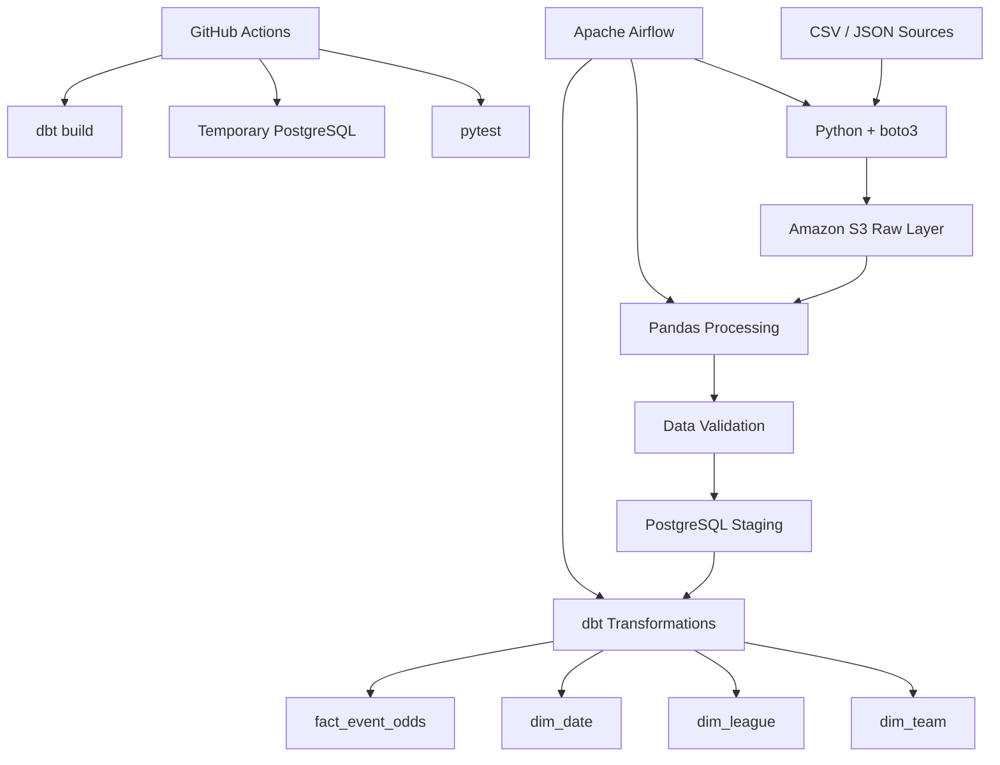
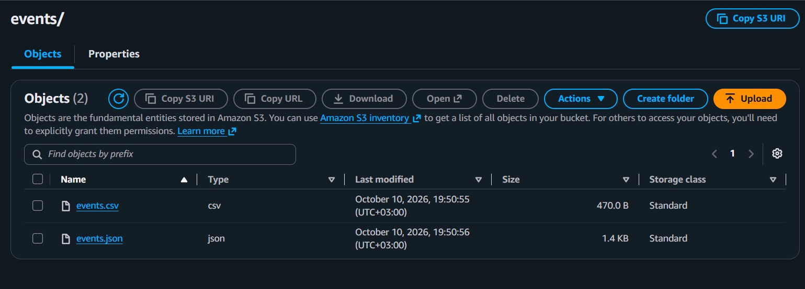
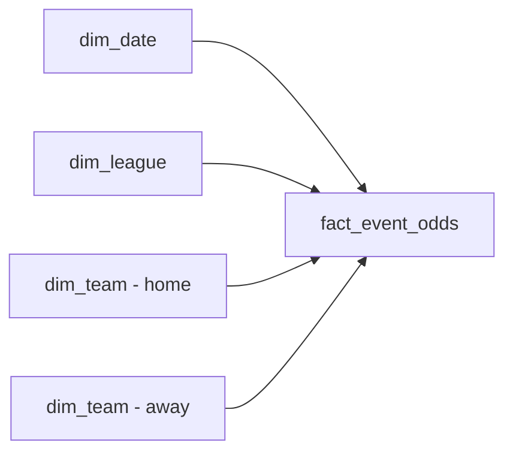
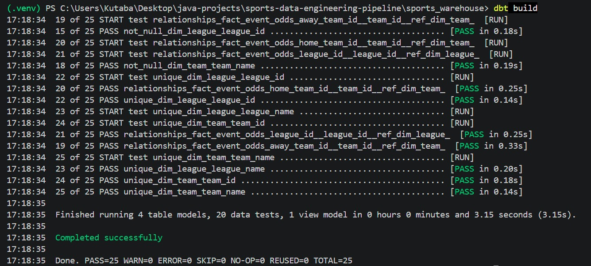
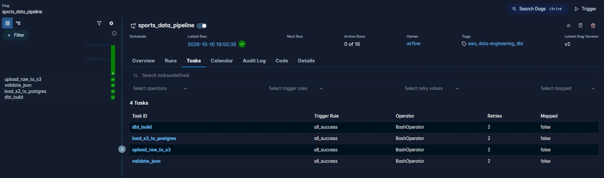
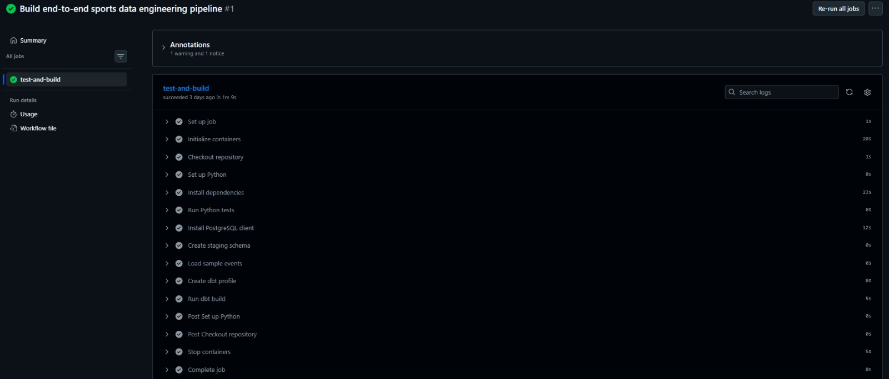

# Sports Data Engineering Pipeline

[](https://github.com/Kutaba-Victor-30127/sports-data-engineering-pipeline/actions)

End-to-end data engineering pipeline built with **Python, AWS S3, PostgreSQL, dbt, Apache Airflow, Docker and GitHub Actions**.

The project processes both structured CSV and semi-structured JSON sports event data, stores raw files in Amazon S3, validates and loads data into PostgreSQL, transforms it into a dimensional warehouse with dbt, and orchestrates the complete workflow with Apache Airflow.

---

## Architecture



### Pipeline Flow

```text
CSV + JSON
    ↓
Python / boto3
    ↓
Amazon S3
Raw Layer
    ↓
Pandas
    ↓
Data Validation
    ↓
PostgreSQL
staging.raw_events
    ↓
dbt
    ↓
Analytics Warehouse
    ├── dim_team
    ├── dim_league
    ├── dim_date
    └── fact_event_odds
```

---

## Tech Stack

| Area | Technologies |
|---|---|
| Language | Python |
| Cloud | AWS S3 |
| AWS SDK | boto3 |
| Data Processing | Pandas |
| Database | PostgreSQL |
| Database Access | SQLAlchemy, psycopg2 |
| Transformations | dbt |
| Orchestration | Apache Airflow |
| Containerization | Docker, Docker Compose |
| Testing | pytest, dbt tests |
| CI | GitHub Actions |
| Version Control | Git, GitHub |

---

## 1. AWS S3 Raw Layer

The pipeline supports two source formats:

- structured CSV data
- semi-structured JSON data

Python and `boto3` upload the files to Amazon S3:

```text
raw/events/events.csv
raw/events/events.json
```

S3 acts as the raw data layer and preserves the original source files before downstream processing.

### S3 Raw Data



---

## 2. Semi-Structured JSON Processing

The JSON input contains nested structures such as:

```json
{
  "teams": {
    "home": "Arsenal",
    "away": "Chelsea"
  },
  "odds": {
    "home": 1.85,
    "draw": 3.40,
    "away": 4.20
  }
}
```

The ingestion layer converts the nested structure into an analytics-friendly DataFrame:

```text
S3 JSON
   ↓
json.loads()
   ↓
pandas.json_normalize()
   ↓
DataFrame
```

Nested fields are normalized into columns such as:

```text
home_team
away_team
home_odds
draw_odds
away_odds
```

---

## 3. Data Validation

Before loading data downstream, Python validation rules verify data quality.

The validation layer checks conditions such as:

- required columns are present
- required values are not null
- betting odds are positive
- source records follow the expected schema

Invalid records raise an exception and stop the pipeline before bad data reaches the warehouse.

---

## 4. PostgreSQL Staging Layer

Validated event data is loaded into:

```text
staging.raw_events
```

Python connects to PostgreSQL through SQLAlchemy.

The staging load runs inside a database transaction and refreshes the staging table before inserting the new dataset.

PostgreSQL runs inside Docker and uses a persistent Docker volume.

---

## 5. ELT with dbt

After the data is loaded into PostgreSQL, transformations are handled by dbt.

The architecture follows an ELT-style workflow:

```text
Extract
   ↓
Amazon S3

Load
   ↓
PostgreSQL staging

Transform
   ↓
dbt
```

### Staging Model

```text
analytics.stg_events
```

The staging model performs lightweight cleaning and normalization and is materialized as a **view**.

### Warehouse Models

```text
analytics.dim_team
analytics.dim_league
analytics.dim_date
analytics.fact_event_odds
```

The dimensional models are materialized as PostgreSQL **tables**.

---

## 6. Dimensional Data Model



### `fact_event_odds`

The central fact table contains:

```text
event_id
date_id
league_id
home_team_id
away_team_id
event_time
home_odds
draw_odds
away_odds
```

### `dim_team`

```text
team_id
team_name
```

### `dim_league`

```text
league_id
league_name
```

### `dim_date`

```text
date_id
full_date
year
month
day
```

---

## 7. dbt Testing

The warehouse layer includes automated dbt data-quality tests.

Tests validate:

- `not_null`
- `unique`
- relationships between fact and dimension tables

Examples:

```text
fact_event_odds.date_id
    → dim_date.date_id

fact_event_odds.league_id
    → dim_league.league_id

fact_event_odds.home_team_id
    → dim_team.team_id

fact_event_odds.away_team_id
    → dim_team.team_id
```

The current dbt build executes:

```text
4 table models
1 view model
20 data tests
25 total operations
```

### Successful dbt Build



---

## 8. Apache Airflow Orchestration

Apache Airflow orchestrates the complete pipeline through the:

```text
sports_data_pipeline
```

DAG.

The workflow is:

```text
upload_raw_to_s3
        ↓
validate_json
        ↓
load_s3_to_postgres
        ↓
dbt_build
```

Each task depends on successful completion of the previous task.

The DAG also includes retry handling:

```text
retries = 2
retry_delay = 30 seconds
```

This makes the workflow more resilient to temporary failures such as network or service interruptions.

### Successful Airflow Run



Airflow provides:

- task dependency management
- execution monitoring
- task-level logs
- retries
- manual triggering
- failure visibility

---

## 9. Continuous Integration

The project includes a GitHub Actions CI pipeline:

```text
.github/workflows/ci.yml
```

The workflow runs automatically on:

```text
push → main
pull request → main
```

### CI Flow

```text
Checkout repository
        ↓
Set up Python
        ↓
Install dependencies
        ↓
Run pytest
        ↓
Start temporary PostgreSQL
        ↓
Create staging schema
        ↓
Load sample data
        ↓
Create dbt profile
        ↓
Run dbt build
```

The CI environment creates its own temporary PostgreSQL service, allowing the Python and dbt layers to be validated independently from the developer's local environment.

### GitHub Actions Success



---

## 10. Python Testing

Python tests are implemented with `pytest`.

Run:

```bash
python -m pytest
```

The current test suite includes scenarios for:

```text
valid event data → accepted
negative betting odds → rejected
```

The project therefore includes multiple quality gates:

```text
Python validation
       +
pytest
       +
dbt tests
       +
GitHub Actions
```

---

## 11. Logging

The ingestion modules use Python's standard `logging` library.

Example output:

```text
INFO | Uploaded events.csv to S3
INFO | Read raw/events/events.csv from S3
INFO | Loaded events from S3
INFO | Loaded records into staging.raw_events
```

Airflow also captures execution logs for each individual pipeline task.

---

## 12. Docker Infrastructure

Docker Compose runs the main local infrastructure.

Containers:

```text
sports_postgres
sports_airflow
```

From the host machine, PostgreSQL is accessed through:

```text
localhost:5433
```

Inside Docker, Airflow connects directly to PostgreSQL through the Docker network:

```text
postgres:5432
```

This keeps local host networking separate from container-to-container communication.

---

## Project Structure

```text
sports-data-engineering-pipeline/
│
├── .github/
│   └── workflows/
│       └── ci.yml
│
├── airflow/
│   ├── dags/
│   │   └── sports_pipeline_dag.py
│   │
│   └── dbt/
│       └── profiles.yml
│
├── data/
│   └── raw/
│       ├── events.csv
│       └── events.json
│
├── docs/
│   ├── airflow-success.png
│   ├── dbt-build-success.png
│   ├── github-actions-success.png
│   └── s3-raw-events.png
│
├── sports_warehouse/
│   ├── models/
│   │   ├── staging/
│   │   │   └── stg_events.sql
│   │   │
│   │   ├── marts/
│   │   │   ├── dim_date.sql
│   │   │   ├── dim_league.sql
│   │   │   ├── dim_team.sql
│   │   │   └── fact_event_odds.sql
│   │   │
│   │   ├── schema.yml
│   │   └── sources.yml
│   │
│   └── dbt_project.yml
│
├── sql/
│   └── create_staging.sql
│
├── src/
│   ├── aws/
│   │   └── s3_client.py
│   │
│   ├── database/
│   │   └── connection.py
│   │
│   ├── ingestion/
│   │   ├── load_events.py
│   │   └── load_json_events.py
│   │
│   └── validation/
│       └── event_validator.py
│
├── tests/
│   └── test_ingestion.py
│
├── .env.example
├── .gitignore
├── docker-compose.yml
├── Dockerfile.airflow
├── requirements.txt
└── README.md
```

---

# Running Locally

## Prerequisites

Install:

- Python
- Docker Desktop
- Git
- AWS CLI

An AWS account and S3 bucket are also required.

---

## 1. Clone the Repository

```bash
git clone https://github.com/Kutaba-Victor-30127/sports-data-engineering-pipeline.git

cd sports-data-engineering-pipeline
```

---

## 2. Create a Virtual Environment

```bash
python -m venv .venv
```

Windows PowerShell:

```powershell
.\.venv\Scripts\Activate.ps1
```

---

## 3. Install Dependencies

```bash
pip install -r requirements.txt
```

---

## 4. Configure Environment Variables

Create:

```text
.env
```

based on:

```text
.env.example
```

Example:

```env
POSTGRES_HOST=localhost
POSTGRES_DB=sports_warehouse
POSTGRES_USER=sports_user
POSTGRES_PASSWORD=your_password
POSTGRES_PORT=5433

AWS_REGION=eu-north-1
S3_BUCKET_NAME=your-s3-bucket-name

AWS_CREDENTIALS_PATH=C:/Users/your-user/.aws
```

---

## 5. Configure AWS CLI

Configure AWS credentials locally:

```bash
aws configure
```

Verify authentication:

```bash
aws sts get-caller-identity
```

AWS credentials are never stored in this repository.

---

## 6. Start Docker Infrastructure

```bash
docker compose up -d --build
```

Verify:

```bash
docker ps
```

Expected project containers:

```text
sports_postgres
sports_airflow
```

---

## 7. Run the Ingestion Pipeline Manually

Upload source data to S3:

```bash
python -m src.aws.s3_client
```

Load CSV data from S3 into PostgreSQL:

```bash
python -m src.ingestion.load_events
```

Process and validate JSON:

```bash
python -m src.ingestion.load_json_events
```

---

## 8. Run Python Tests

```bash
python -m pytest
```

---

## 9. Run dbt

```bash
cd sports_warehouse

dbt build
```

A successful build should finish with:

```text
PASS=25
ERROR=0
```

---

## 10. Run the Airflow Pipeline

Airflow is available locally at:

```text
http://localhost:8082
```

Trigger:

```text
sports_data_pipeline
```

The DAG executes:

```text
upload_raw_to_s3
        ↓
validate_json
        ↓
load_s3_to_postgres
        ↓
dbt_build
```

---

## Security

The repository does not contain AWS credentials or the local `.env` file.

Security practices used in the project include:

- `.env` excluded from Git
- AWS credentials stored outside the repository
- `.env.example` containing only configuration templates
- dedicated IAM identity for project access
- S3 permissions restricted to project resources
- no AWS root access keys used
- Docker configuration driven through environment variables

---

## Engineering Concepts Demonstrated

This project demonstrates practical experience with:

- Python data engineering
- AWS S3
- boto3
- structured data
- semi-structured JSON
- Pandas
- ETL / ELT workflows
- PostgreSQL
- SQL
- SQLAlchemy
- staging layers
- dbt
- dimensional modelling
- fact and dimension tables
- data warehousing
- data-quality testing
- Apache Airflow DAGs
- dependency management
- retry handling
- Docker
- Docker networking
- persistent volumes
- pytest
- GitHub Actions
- CI pipelines
- logging
- secure environment configuration
- Git version control

---

## Future Improvements

Possible extensions include:

- AWS Glue
- Amazon Athena
- Amazon Redshift
- Apache Spark / PySpark
- dbt incremental models
- Airflow scheduling
- alerting and notifications
- Terraform infrastructure as code
- centralized monitoring
- larger datasets
- external sports APIs
- partitioned S3 datasets

---

## Author

**Victor Kutaba**

GitHub: [Kutaba-Victor-30127](https://github.com/Kutaba-Victor-30127)

Repository: [sports-data-engineering-pipeline](https://github.com/Kutaba-Victor-30127/sports-data-engineering-pipeline)