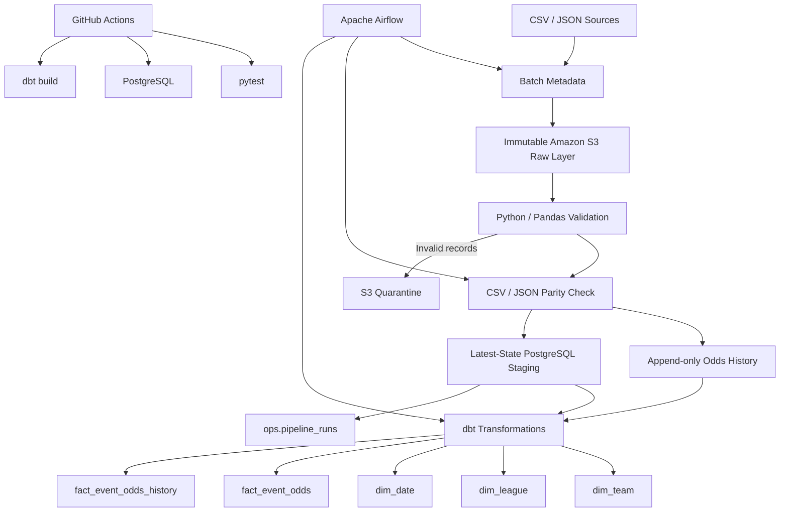
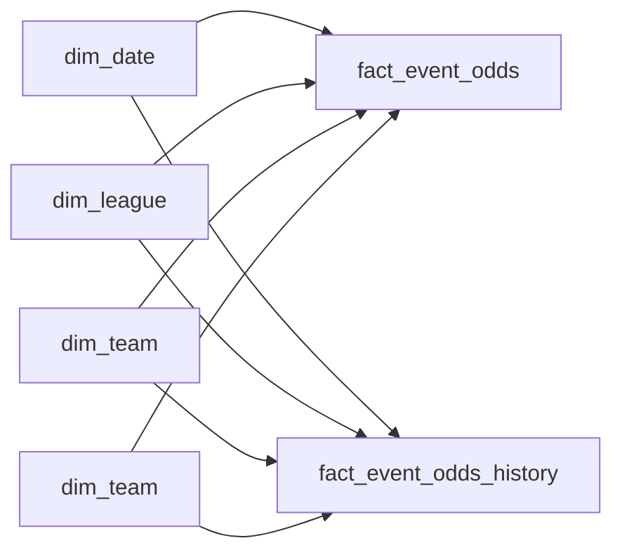

# Sports Data Engineering Pipeline

[](https://github.com/Kutaba-Victor-30127/sports-data-engineering-pipeline/actions)

Production-style data engineering project built with **Python, AWS S3, PostgreSQL, dbt, Apache Airflow, Docker, pytest and GitHub Actions**.

The pipeline ingests structured CSV and semi-structured JSON sports-event data, stores immutable raw batches in Amazon S3, validates and quarantines invalid records, verifies CSV/JSON batch parity, performs replay-safe incremental PostgreSQL ingestion, preserves historical betting-odds versions, builds a dimensional analytics warehouse with dbt, tracks execution metrics and includes reproducible ingestion benchmarks.

## Architecture



## Key Engineering Features

- Immutable Amazon S3 raw batches partitioned by `ingestion_date` and `batch_id`
- CSV and nested JSON ingestion
- CSV/JSON semantic parity validation before database loading
- Centralized event data contract
- Integer, numeric and timestamp type validation
- Row-level validation and S3 quarantine
- Incremental PostgreSQL ingestion using version-aware UPSERTs
- Replay-safe and idempotent batch processing
- Protection against stale and out-of-order source data
- Append-only betting-odds history
- Latest-state and historical-state separation
- Historical replay protection using `(event_id, source_updated_at)`
- Batch-level observability using `run_id`
- SUCCESS / FAILED execution tracking
- Inserted, updated, ignored, valid and rejected row metrics
- Atomic history + latest-state database transactions
- Apache Airflow orchestration with retries
- Dimensional analytics warehouse built with dbt
- Source lineage propagated into fact models
- Automated Python and dbt data-quality testing
- Dockerized infrastructure
- GitHub Actions CI
- Pinned Python and Airflow dependencies
- Reproducible PostgreSQL ingestion performance benchmarks

## Tech Stack

| Area | Technologies |
|---|---|
| Language | Python |
| Data Processing | pandas |
| Cloud Storage | AWS S3 |
| AWS SDK | boto3 |
| Database | PostgreSQL |
| Database Access | SQLAlchemy, psycopg2 |
| Transformations | dbt |
| Orchestration | Apache Airflow |
| Containerization | Docker, Docker Compose |
| Testing | pytest, dbt tests |
| CI/CD | GitHub Actions |
| Version Control | Git, GitHub |

## Immutable S3 Raw Layer

Every new ingestion receives a unique `batch_id` and is stored under an immutable S3 path:

```text
raw/events/
└── ingestion_date=2026-11-17/
    └── batch_id=<UUID>/
        ├── events.csv
        └── events.json
```

Batch metadata contains:

```text
batch_id
ingestion_date
csv_key
json_key
```

`batch_id` identifies the source data.

Each processing attempt receives a separate `run_id`, meaning the same immutable batch can be retried or replayed while preserving its execution history.

Example:

```text
batch-A
├── run 101 → FAILED
├── run 102 → FAILED
└── run 103 → SUCCESS
```

## Data Contract and Validation

The centralized data contract defines the required fields and expected data types.

Required fields include:

```text
event_id
sport
league
home_team
away_team
event_time
home_odds
draw_odds
away_odds
source_updated_at
```

Validation includes:

- required columns
- non-null required values
- integer `event_id`
- duplicate `event_id` detection within a batch
- different home and away teams
- valid timestamps
- numeric odds
- positive odds
- finite odds
- valid source-version timestamps

Examples:

```text
event_id = 123      → valid
event_id = "123"    → converted to integer
event_id = 1.5      → rejected
event_id = "abc"    → rejected
```

Invalid records are separated from valid records instead of crashing the entire batch.

## CSV / JSON Batch Parity

The raw layer stores both CSV and JSON representations of the source events.

The JSON input is normalized from nested structures such as:

```text
teams.home
teams.away
odds.home
odds.draw
odds.away
```

into the same canonical event schema used by the CSV path.

Before loading data into PostgreSQL, the pipeline:

```text
CSV
 ↓
validate + normalize
               \
                → canonical comparison
               /
JSON
 ↓
normalize + validate
```

The parity check compares the business columns defined in the data contract.

Rows are sorted by `event_id`, and timestamp representations are normalized before comparison.

For example:

```text
2026-09-21 18:00:00
```

and:

```text
2026-09-21T18:00:00
```

are treated as the same timestamp.

If CSV and JSON contain different business values, the batch fails before database loading.

## Quarantine Layer

Validation partitions each batch into:

```text
valid_df
rejected_df
```

Valid records continue through the pipeline.

Rejected records are written to:

```text
rejected/events/
└── ingestion_date=<date>/
    └── batch_id=<UUID>/
        └── rejected.json
```

Rejected records preserve metadata including:

```text
batch_id
source_file
rejection_reason
```

This prevents invalid records from reaching the warehouse while keeping them available for investigation.

## Latest-State Incremental Ingestion

The current version of every event is stored in:

```text
staging.raw_events
```

The production pipeline does not truncate this table.

Instead, PostgreSQL performs an UPSERT using `event_id` as the conflict key.

An existing event is updated only when:

```text
incoming source_updated_at > stored source_updated_at
```

Example:

```text
Stored version

event_id = 1
home_odds = 1.95
source_updated_at = 11:00
```

A newer source version arrives:

```text
event_id = 1
home_odds = 1.85
source_updated_at = 12:00
```

The latest-state record becomes:

```text
event_id = 1
home_odds = 1.85
source_updated_at = 12:00
```

If an older `10:00` version is replayed afterwards, it cannot overwrite the `12:00` version.

This provides protection against:

- stale source data
- late-arriving batches
- accidental historical replay
- duplicate processing

## Append-Only Odds History

In addition to latest state, every unique source version is stored in:

```text
staging.event_odds_history
```

The historical table is append-only.

Its logical source-version key is:

```text
(event_id, source_updated_at)
```

and PostgreSQL enforces:

```sql
UNIQUE (
    event_id,
    source_updated_at
)
```

A replay of the exact same version is ignored:

```text
event 1 @ 11:00
→ first processing: INSERT

event 1 @ 11:00
→ replay: IGNORE
```

A newer version is preserved as a separate historical row:

```text
event 1 @ 11:00 → 1.95
event 1 @ 12:00 → 1.85
```

### Verified End-to-End Example

The project was tested with two consecutive versions of the same event.

Historical state:

```text
history_id | event_id | home_odds | source_updated_at
-----------+----------+-----------+-------------------
11         | 1        | 1.95      | 2026-10-26 11:00
16         | 1        | 1.85      | 2026-10-26 12:00
```

Latest state:

```text
event_id | home_odds | source_updated_at
---------+-----------+-------------------
1        | 1.85      | 2026-10-26 12:00
```

This demonstrates the two distinct storage semantics:

```text
fact_event_odds
→ latest version only

fact_event_odds_history
→ all unique source versions
```

`history_id` is a technical surrogate key generated globally by PostgreSQL. Historical version identity is determined by:

```text
(event_id, source_updated_at)
```

## Atomic Latest-State and History Writes

Historical and latest-state writes happen inside the same PostgreSQL transaction:

```text
BEGIN
   ↓
INSERT historical versions
   ↓
UPSERT latest state
   ↓
mark pipeline run SUCCESS
   ↓
COMMIT
```

If any database operation fails:

```text
ROLLBACK
```

This prevents inconsistent states where a historical version exists but the latest-state table was not updated, or vice versa.

## Batch Observability

Execution metadata is stored in:

```text
ops.pipeline_runs
```

The design separates:

```text
batch_id = source batch identity
run_id   = one processing attempt
```

A single source batch can have several attempts:

```text
batch-A
├── run 1 → FAILED
├── run 2 → FAILED
└── run 3 → SUCCESS
```

Tracked information includes:

```text
source_row_count
valid_row_count
rejected_row_count
inserted_count
updated_count
ignored_count
started_at
finished_at
status
error_message
```

`NULL` and `0` intentionally have different meanings.

Example:

```text
source_row_count = NULL
```

means processing failed before that metric could be measured.

```text
source_row_count = 0
```

means the metric was measured and the source contained zero rows.

Upload failures, validation failures and ingestion failures are recorded as `FAILED`.

## Apache Airflow Orchestration

Airflow orchestrates:

```text
sports_data_pipeline
```

The DAG is:

```text
prepare_batch
      ↓
ingest_batch
      ↓
dbt_build
```

### `prepare_batch`

Creates immutable batch metadata including:

```text
batch_id
ingestion_date
csv_key
json_key
```

### `ingest_batch`

Runs the shared Python ingestion flow:

```text
create run_id
     ↓
upload CSV + JSON to S3
     ↓
validate JSON
     ↓
validate CSV
     ↓
CSV / JSON parity check
     ↓
quarantine invalid records
     ↓
append unique historical versions
     ↓
UPSERT latest state
     ↓
mark run SUCCESS
```

### Retry Semantics

Airflow is configured with:

```text
retries = 2
retry_delay = 30 seconds
```

A retry keeps the same `batch_id` while receiving a new `run_id`.

Example:

```text
batch ABC

run 50 → FAILED
run 51 → FAILED
run 52 → SUCCESS
```

## dbt Analytics Warehouse

dbt transforms PostgreSQL staging data into a dimensional warehouse.

### Staging Models

```text
analytics.stg_events
analytics.stg_event_odds_history
```

### Dimensions

```text
analytics.dim_team
analytics.dim_league
analytics.dim_date
```

### Latest-State Fact

```text
analytics.fact_event_odds
```

Contains the most recent version of each event.

### Historical Fact

```text
analytics.fact_event_odds_history
```

Contains every unique source version of every event.

Both fact models preserve lineage metadata:

```text
source_file
batch_id
ingested_at
source_updated_at
loaded_at
```

The dimensional model uses:

```text
date_id
league_id
home_team_id
away_team_id
```

with relationships to the appropriate dimensions.



## dbt Historical Uniqueness Test

Historical `event_id` values are intentionally not unique because one event can have multiple source versions.

Instead, the logical version key is:

```text
(event_id, source_updated_at)
```

A custom dbt test checks:

```sql
select
    event_id,
    source_updated_at,
    count(*) as version_count

from {{ ref('fact_event_odds_history') }}

group by
    event_id,
    source_updated_at

having count(*) > 1
```

dbt custom tests pass when they return:

```text
0 rows
```

Therefore the test fails if the same historical source version appears more than once.

## Automated Testing and Data Quality

The project combines Python behavioral tests with dbt warehouse-quality tests.

### pytest

The current Python test suite contains **25 automated tests**.

Coverage includes:

- valid event validation
- missing required fields
- integer `event_id` validation
- fractional `event_id` rejection
- non-numeric `event_id` rejection
- negative odds rejection
- non-numeric odds rejection
- invalid timestamps
- event contract metadata
- CSV/JSON batch parity
- CSV/JSON mismatch detection
- replay-safe incremental ingestion
- stale-version protection
- quarantine behavior
- PostgreSQL constraints
- observability SUCCESS state
- observability FAILED state
- S3 upload failure tracking
- history replay idempotency
- historical source-version persistence

Run:

```bash
python -m pytest -v
```

Expected:

```text
25 passed
```

### dbt

The current dbt build executes:

```text
5 table models
2 view models
41 data tests
48 total operations
```

A successful build finishes with:

```text
PASS=48
WARN=0
ERROR=0
SKIP=0
TOTAL=48
```

dbt tests cover:

- `not_null`
- `unique`
- fact-to-dimension relationships
- positive odds
- historical source-version uniqueness
- lineage integrity

## Continuous Integration

GitHub Actions runs automatically on:

```text
push → main
pull request → main
```

The workflow:

```text
Checkout repository
        ↓
Set up Python 3.13
        ↓
Install pinned dependencies
        ↓
Provision PostgreSQL
        ↓
Apply schemas and migrations
        ↓
Run pytest
        ↓
Load sample data
        ↓
Run dbt build
```

CI provisions PostgreSQL from a clean service rather than depending on manually configured local state.

## Database Migrations

Database setup currently includes:

```text
create_staging.sql
004_pipeline_runs.sql
005_pipeline_run_attempts.sql
006_source_updated_at_not_null.sql
007_event_odds_history.sql
```

Key changes include:

```text
004 → pipeline observability table
005 → run_id attempts and replay-aware metrics
006 → source_updated_at database integrity
007 → append-only historical odds storage
```

Migration `005` is safely rerunnable and uses conditional DDL where appropriate.

## Performance Benchmark

The PostgreSQL incremental ingestion path was benchmarked with synthetic datasets of **10,000** and **100,000** event records.

### Results

| Scenario | Rows | Time | Throughput | Inserted | Updated | Ignored |
|---|---:|---:|---:|---:|---:|---:|
| Initial load | 10,000 | 7.565 s | 1,322 rows/s | 10,000 | 0 | 0 |
| Idempotent replay | 10,000 | 8.082 s | 1,237 rows/s | 0 | 0 | 10,000 |
| 10% incremental update | 10,000 | 7.218 s | 1,385 rows/s | 0 | 1,000 | 9,000 |
| Initial load | 100,000 | 76.099 s | 1,314 rows/s | 100,000 | 0 | 0 |
| Idempotent replay | 100,000 | 73.133 s | 1,367 rows/s | 0 | 0 | 100,000 |
| 10% incremental update | 100,000 | 71.452 s | 1,400 rows/s | 0 | 10,000 | 90,000 |

The benchmark demonstrates approximately stable throughput of **1.2k–1.4k rows/second** as the dataset grows from 10,000 to 100,000 rows.

The benchmark measures the real PostgreSQL `load_to_staging()` path and intentionally excludes:

- S3 transfer
- validation
- Airflow orchestration
- dbt execution

Benchmark execution runs inside a database transaction and rolls back after completion.

### Run Benchmark

```bash
python -m benchmarks.benchmark_ingestion --row-count 10000
```

```bash
python -m benchmarks.benchmark_ingestion --row-count 100000
```

or:

```bash
python -m benchmarks.benchmark_ingestion --row-count 10000 100000
```

## Docker Infrastructure

Docker Compose runs the main services:

```text
sports_postgres
sports_airflow
```

Host PostgreSQL access:

```text
localhost:5433
```

Container PostgreSQL access:

```text
postgres:5432
```

Airflow UI:

```text
http://localhost:8082
```

## Project Structure

```text
sports-data-engineering-pipeline/
├── .github/
│   └── workflows/
│       └── ci.yml
├── airflow/
│   ├── dags/
│   │   └── sports_pipeline_dag.py
│   └── dbt/
│       └── profiles.yml
├── benchmarks/
│   └── benchmark_ingestion.py
├── data/
│   └── raw/
│       ├── events.csv
│       └── events.json
├── docs/
├── sports_warehouse/
│   ├── models/
│   │   ├── staging/
│   │   │   ├── stg_events.sql
│   │   │   └── stg_event_odds_history.sql
│   │   └── marts/
│   │       ├── dim_date.sql
│   │       ├── dim_league.sql
│   │       ├── dim_team.sql
│   │       ├── fact_event_odds.sql
│   │       └── fact_event_odds_history.sql
│   └── tests/
│       ├── assert_positive_event_odds.sql
│       └── assert_unique_event_history_version.sql
├── sql/
│   ├── create_staging.sql
│   ├── 004_pipeline_runs.sql
│   ├── 005_pipeline_run_attempts.sql
│   ├── 006_source_updated_at_not_null.sql
│   └── 007_event_odds_history.sql
├── src/
│   ├── aws/
│   │   └── s3_client.py
│   ├── contracts/
│   │   └── event_contract.py
│   ├── database/
│   │   └── connection.py
│   ├── ingestion/
│   │   ├── load_events.py
│   │   ├── load_json_events.py
│   │   └── run_batch.py
│   ├── observability/
│   │   └── pipeline_runs.py
│   └── validation/
│       ├── batch_parity.py
│       └── event_validator.py
├── tests/
│   ├── conftest.py
│   ├── test_batch_parity.py
│   ├── test_database_constraints.py
│   ├── test_history.py
│   ├── test_incremental_ingestion.py
│   ├── test_ingestion.py
│   ├── test_observability.py
│   └── test_quarantine.py
├── .env.example
├── docker-compose.yml
├── Dockerfile.airflow
├── requirements.txt
└── README.md
```

## Running Locally

### 1. Clone

```bash
git clone https://github.com/Kutaba-Victor-30127/sports-data-engineering-pipeline.git
cd sports-data-engineering-pipeline
```

### 2. Create Environment

```bash
python -m venv .venv
```

Windows PowerShell:

```powershell
.\.venv\Scripts\Activate.ps1
```

Install pinned dependencies:

```bash
pip install -r requirements.txt
```

### 3. Configure Environment

Create `.env` from `.env.example`.

Example:

```env
POSTGRES_HOST=localhost
POSTGRES_DB=sports_warehouse
POSTGRES_USER=sports_user
POSTGRES_PASSWORD=your_password
POSTGRES_PORT=5433

AWS_REGION=eu-north-1
S3_BUCKET_NAME=your-s3-bucket-name

AWS_CREDENTIALS_PATH=C:/Users/your-user/.aws
```

AWS credentials remain outside the repository.

### 4. Start Infrastructure

```bash
docker compose up -d --build
```

### 5. Run Pipeline

```bash
python -m src.ingestion.run_batch
```

The ingestion flow:

```text
create batch metadata
        ↓
create observable run
        ↓
upload immutable CSV + JSON
        ↓
validate and normalize data
        ↓
CSV / JSON parity check
        ↓
quarantine invalid records
        ↓
append unique historical versions
        ↓
UPSERT latest state
        ↓
mark execution SUCCESS
```

### 6. Replay Existing Batch

```bash
python -m src.ingestion.load_events \
  --s3-key "<existing-s3-key>" \
  --batch-id "<existing-batch-id>"
```

The original `batch_id` is preserved while the processing attempt receives a new `run_id`.

### 7. Run Python Tests

```bash
python -m pytest -v
```

Expected:

```text
25 passed
```

### 8. Run dbt

```bash
cd sports_warehouse
dbt build
```

Expected:

```text
PASS=48
WARN=0
ERROR=0
TOTAL=48
```

### 9. Trigger Airflow

```bash
docker exec sports_airflow airflow dags trigger sports_data_pipeline
```

Check runs:

```bash
docker exec sports_airflow airflow dags list-runs sports_data_pipeline
```

## Security

Security practices include:

- `.env` excluded from Git
- AWS credentials stored outside the repository
- `.env.example` contains templates only
- dedicated IAM project identity
- project-scoped S3 permissions
- no AWS root access keys
- environment-driven Docker configuration

## Engineering Concepts Demonstrated

- Python data engineering
- SQL and relational databases
- ETL / ELT
- AWS S3
- immutable raw storage
- CSV and JSON ingestion
- semantic source parity validation
- batch processing
- incremental ingestion
- PostgreSQL UPSERT
- append-only historical storage
- current-state vs historical-state modeling
- idempotency
- replay safety
- stale-data protection
- late-arriving data handling
- source versioning
- surrogate keys
- logical version keys
- data contracts
- row-level validation
- quarantine patterns
- data lineage
- batch observability
- retry semantics
- database transactions
- atomicity
- SQLAlchemy
- pandas
- dbt
- dimensional modelling
- fact and dimension tables
- custom dbt tests
- Apache Airflow
- orchestration
- Docker
- pytest
- GitHub Actions
- CI
- reproducible benchmarking
- logging
- secure configuration

## Future Improvements

Potential next steps:

- optimize bulk ingestion performance
- add historical odds analytics such as opening vs latest odds
- calculate price movement and volatility
- ingest data from an external sports API
- build a BI dashboard on top of the warehouse
- extend monitoring and alerting
- manage cloud infrastructure with Infrastructure as Code

## Author

**Victor Kutaba**

GitHub: Kutaba-Victor-30127